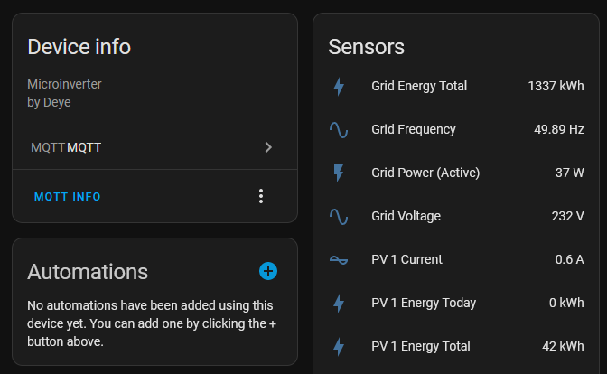

# Deye Dummy Cloud (Node) - Home Assistant App

This is a Node.js service that mocks the Deye/Solarman cloud and publishes all the data to an MQTT broker. It also takes care of Home Assistant autodiscovery leading to things just working.

> [!IMPORTANT]
> **HA 2026.11+**: This app uses the new `config.yaml` format (formerly known as "add-ons", now called "apps").
> It must be installed via the **App store** (Settings → Apps → Install app), not the Marketplace (HACS).
> The Marketplace only handles integrations, themes, and dashboards — not apps.



## Features

- Mocks the Deye/Solarman cloud server
- Microinverter loggers push data over TCP (port 10000)
- Publishes PV data (voltage, current, power, energy) to MQTT
- Home Assistant auto-discovery for all sensors
- Automatic reconnection to MQTT broker
- TLS support for secure MQTT connections

## Requirements

- Home Assistant Operating System (HAOS) — apps are only available on HAOS
- MQTT broker (built-in Mosquitto or external)
- Deye microinverter with SD card logger (SDI-01 or similar)
- RS485-to-USB adapter if using local logger

## Installation

### Recommended: App store (HAOS)

1. Go to **Settings → Apps → Install app**
2. Click **⋮ → Repositories → Add**
3. Paste: `https://github.com/Hypfer/deye-microinverter-cloud-free`
4. Click **Add**
5. Find **Deye Dummy Cloud (Node)** and click **Install**

> [!NOTE]
> The first install triggers a GitHub Actions build (~2-3 min) to produce the Docker image.
> If the app doesn't appear after adding the repository, wait for the build to complete, then refresh your browser.

### Not supported: Marketplace (HACS)

The Marketplace (built-in HACS) only handles **integrations**, **themes**, and **dashboards**.
Apps (formerly add-ons) are a separate category managed by the HAOS Supervisor.
Do not add this repository to the Marketplace — it will report "no content to install".

## Configuration

After installation, go to the app settings:

| Option | Description | Default |
|--------|-------------|---------|
| `log_level` | Log level (trace, debug, info, warn, error, fatal) | `info` |
| `mqtt_broker_url` | MQTT broker URL (e.g., mqtt://core-mosquitto:1883) | `mqtt://core-mosquitto:1883` |
| `mqtt_username` | MQTT username (leave empty for anonymous) | |
| `mqtt_password` | MQTT password (leave empty for anonymous) | |
| `mqtt_check_cert` | Enable TLS certificate checking | `false` |
| `topic_prefix` | MQTT topic prefix for all topics | `deye-dummycloud` |

## Inverter Setup

Using the `/config_hide.html` of the inverter web interface, simply point `Server A Setting` and `Optional Server Setting` to the host this is running on.

I'd still keep the firewall rules preventing the inverter from phoning home in place for good measure.

## MQTT Topics

| Topic | Description |
|-------|-------------|
| `deye-dummycloud/{serial}/pv/{i}/v` | PV{i} voltage (V) |
| `deye-dummycloud/{serial}/pv/{i}/i` | PV{i} current (A) |
| `deye-dummycloud/{serial}/pv/{i}/w` | PV{i} power (W) |
| `deye-dummycloud/{serial}/pv/{i}/kWh_today` | PV{i} daily energy (kWh) |
| `deye-dummycloud/{serial}/pv/{i}/kWh_total` | PV{i] total energy (kWh) |
| `deye-dummycloud/{serial}/grid/active_power_w` | Grid active power (W) |
| `deye-dummycloud/{serial}/grid/kWh_today` | Grid daily energy (kWh) |
| `deye-dummycloud/{serial}/grid/kWh_total` | Grid total energy (kWh) |
| `deye-dummycloud/{serial}/grid/total_efficiency` | Inverter efficiency (%) |

Sensors are automatically discovered by Home Assistant via MQTT Discovery. No manual configuration required.

## Updating

1. Go to **Settings → Apps**
2. Click on **Deye Dummy Cloud (Node)**
3. Click **Update** in the top-right corner

The app auto-updates when a new version is published. To enable auto-update, turn on the **Auto update** toggle on the app's Info tab.

## Troubleshooting

### "Cannot connect to MQTT broker"
- Enable built-in Mosquitto: **Settings → System → Services → Mosquitto**
- Or configure external MQTT in the app settings

### Inverter not connecting
- Verify the inverter is configured to point to this app's host and port (10000)
- Check firewall rules — port 10000 must be accessible from the inverter
- Look at app logs for detailed errors

### No data received
- Verify inverter SD card logger is properly connected
- Check inverter web interface configuration
- Look at app logs for detailed errors

### Repository not showing up in App store
- Refresh your browser after adding the repository
- Ensure the repository contains apps (not integrations or themes)
- Check the **Supervisor** log: **Settings → System → Logs → Supervisor**
- Wait for the GitHub Actions build to complete (first install)

### GitHub Actions build failed
Common causes and fixes:
- **Platform name**: Use `linux/arm/v7` (not `linux/armv7`)
- **Base image**: Use `node:20-alpine` or newer (not older Node versions)
- **Image tag**: Ensure the `image:` field in `config.yaml` matches your ghcr.io path
- **GitHub token**: The workflow uses `secrets.GITHUB_TOKEN` — no extra setup needed

## App Format (HA 2026.11+)

Home Assistant 2026.11+ renamed "add-ons" to "apps" and migrated to a new configuration format:

| Old format (config.json) | New format (config.yaml) |
|--------------------------|--------------------------|
| `"network_mode": "host"` | `host_network: true` |
| `boot: auto` | `homeassistant: 2024.1.0` |
| No `image:` field | `image: ghcr.io/...` (required) |
| JSON syntax | YAML syntax |

This app uses the new `config.yaml` format. See the [official HA docs](https://www.home-assistant.io/common-tasks/os/apps/) for more details.

## Docker Run (standalone)

```bash
docker run -d \
  --name deye-dummycloud \
  --network host \
  -e LOGLEVEL=info \
  -e MQTT_BROKER_URL=mqtt://core-mosquitto:1883 \
  -e MQTT_USERNAME=your-username \
  -e MQTT_PASSWORD=your-password \
  ghcr.io/jekkos/deye-dummycloud-node:latest
```

## License

Apache-2.0 - see [LICENSE](LICENSE) file for details
